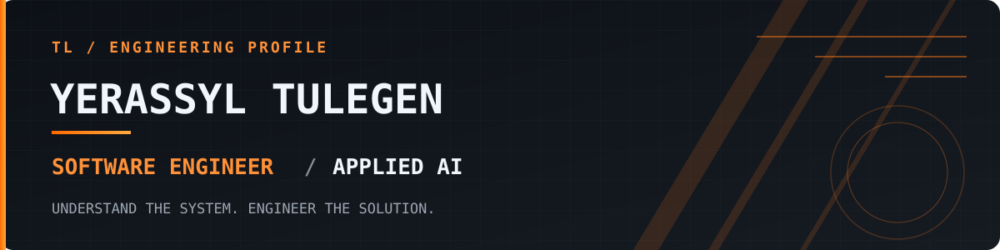

<div align="center">



<br/>

[](https://github.com/Aqyn97)
[](https://github.com/Aqyn97)
[](https://www.linkedin.com/in/yerassyl-tulegen-78757034a/)

</div>

---

### `01 / $ whoami`

```yaml
identity:
  name: Yerassyl Tulegen
  alias: TL
  location: Kazakhstan

engineering:
  direction: Software Engineering + Applied AI
  interests:
    - Backend architecture
    - APIs and data systems
    - Practical AI integration
    - Software quality and maintainability

principle: "Understand why, not only how."
```

I am a software engineering student focused on building a strong foundation in **backend systems** and **applied artificial intelligence**.

I enjoy understanding how software works beneath the interface: how requests flow through services, how data is stored and retrieved, how components interact, and how intelligent features fit into reliable applications.

My approach is simple: **understand the problem, design deliberately, write clear code, and verify the result.**

---

### `02 / engineering domains`

<table>
<tr>
<td width="50%" valign="top">

#### <code>backend.systems</code>

Designing the foundations behind applications.

- Java and object-oriented programming
- Spring Boot and RESTful services
- Relational databases and SQL
- Application structure and separation of concerns
- Error handling, validation, and testing

</td>
<td width="50%" valign="top">

#### <code>applied.ai</code>

Connecting intelligent capabilities with software products.

- Python for software and data workflows
- AI service integration
- Working with model inputs and outputs
- Data flow, reliability, and evaluation
- Human-centered problem solving

</td>
</tr>
</table>

---

### `03 / technical toolkit`

<div align="center">

**LANGUAGES**


**BACKEND & DATA**


**ENGINEERING TOOLS**


</div>

---

### `04 / how I think about software`

```text
                 SOFTWARE ENGINEERING
                         |
           +-------------+-------------+
           |                           |
    BACKEND SYSTEMS                 APPLIED AI
           |                           |
      APIs + DATA                MODELS + DATA
           |                           |
    LOGIC + TESTING            INTEGRATION + EVALUATION
           |                           |
           +-------------+-------------+
                         |
                  USEFUL SOFTWARE
```

Good engineering starts with a clear understanding of the problem. A system should be readable, predictable, and maintainable before anyone describes it as sophisticated.

For AI-enabled software, I care about more than receiving a model response. The surrounding system matters: input quality, validation, data boundaries, error handling, and useful results.

---

### `05 / engineering principles`

| Principle | What it means to me |
|:--|:--|
| `clarity > complexity` | Prefer readable solutions with a clear purpose. |
| `fundamentals first` | Understand the underlying concepts before adopting tools. |
| `design for change` | Keep responsibilities separate and dependencies understandable. |
| `verify behavior` | Test important paths, edge cases, and failure scenarios. |
| `measure before optimizing` | Make technical decisions using evidence. |
| `AI requires evaluation` | Treat model outputs as results to assess, not facts to assume. |

---

### `06 / development process`

<div align="center">

```text
[ UNDERSTAND ] -> [ DESIGN ] -> [ IMPLEMENT ] -> [ TEST ] -> [ IMPROVE ]
      |              |             |            |             |
  Requirements    Structure      Clean code    Behavior     Refinement
```

</div>

My goal is to approach every technical problem with the same discipline, whether I am working on a Java backend, a database query, or an AI integration.

---

### `07 / connect`

<div align="center">

[](https://www.linkedin.com/in/yerassyl-tulegen-78757034a/)
[](mailto:eratulegen99@gmail.com)
[](https://github.com/Aqyn97)

<br/>

<sub><i>“A person excels others through their mind, science, honor, and character.”</i></sub>

<sub>Abay</sub>

<br/><br/>


</div>
